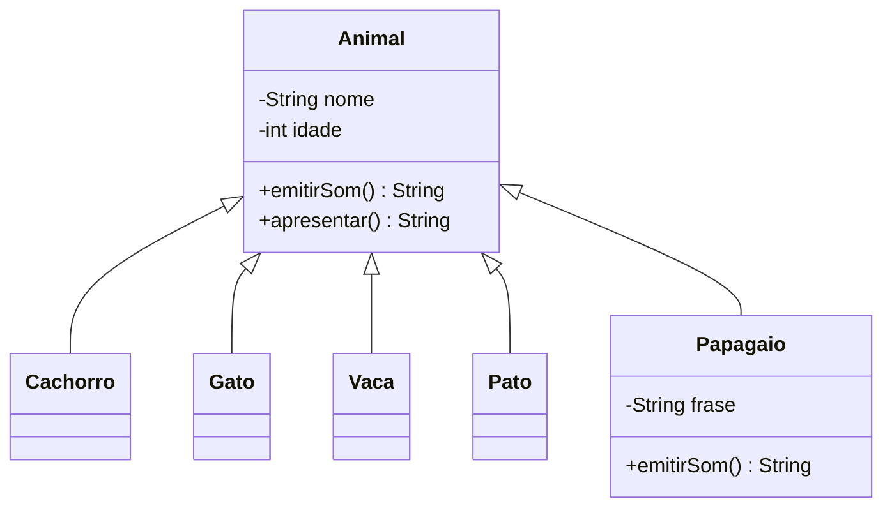
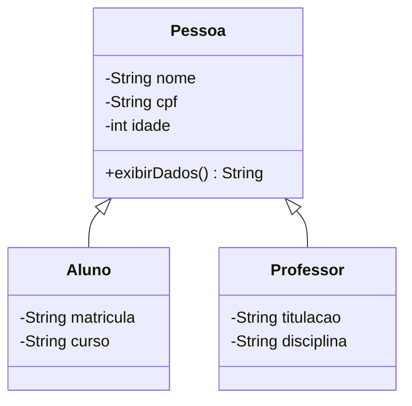
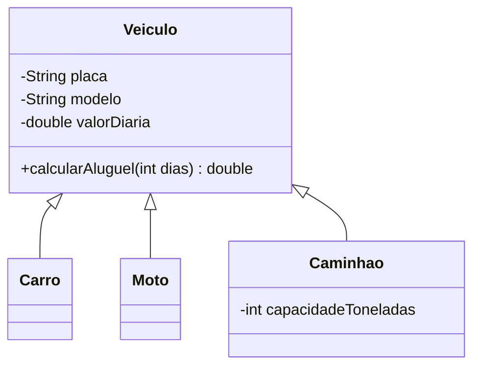
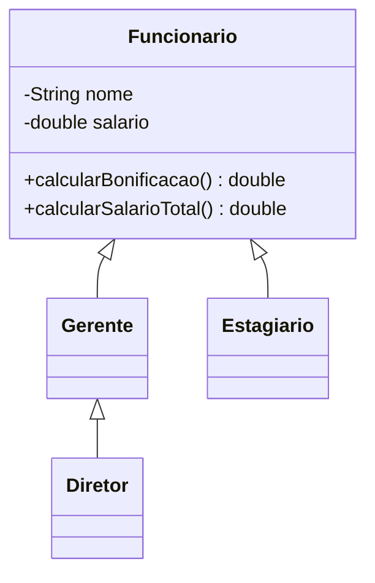
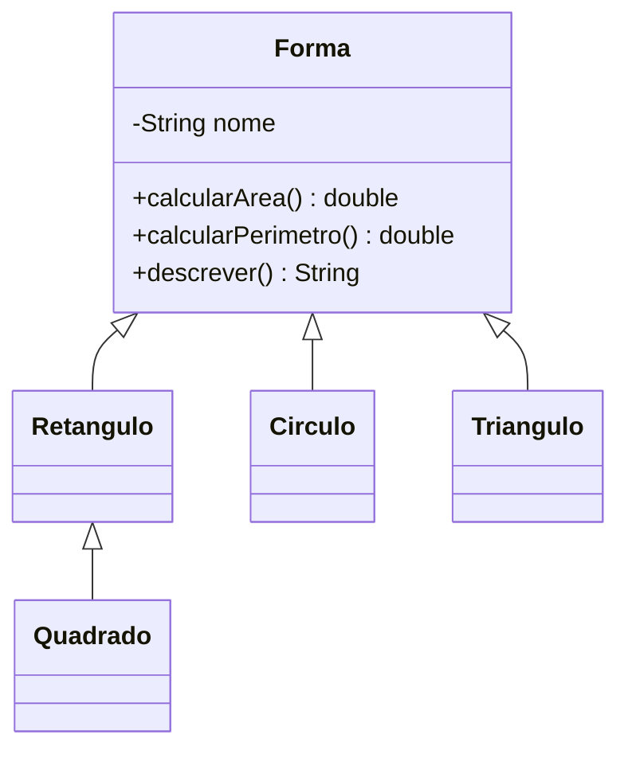
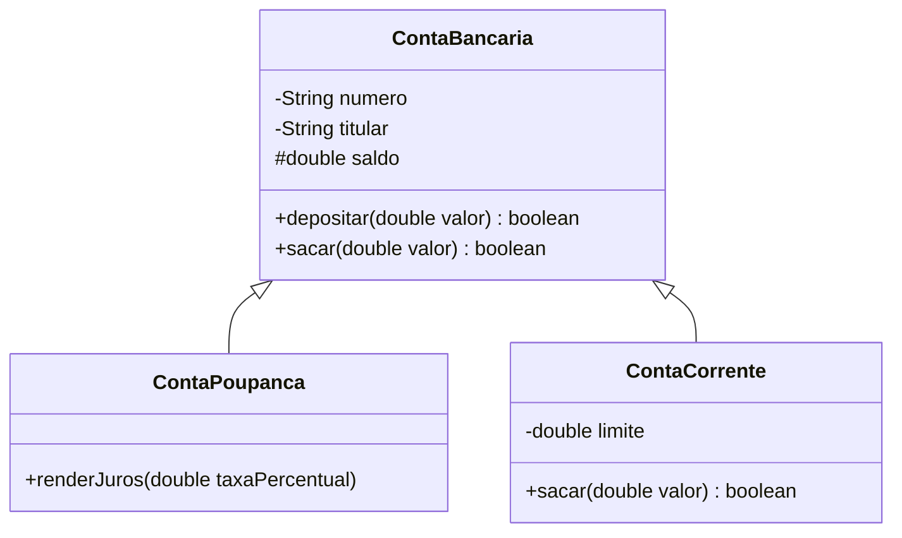
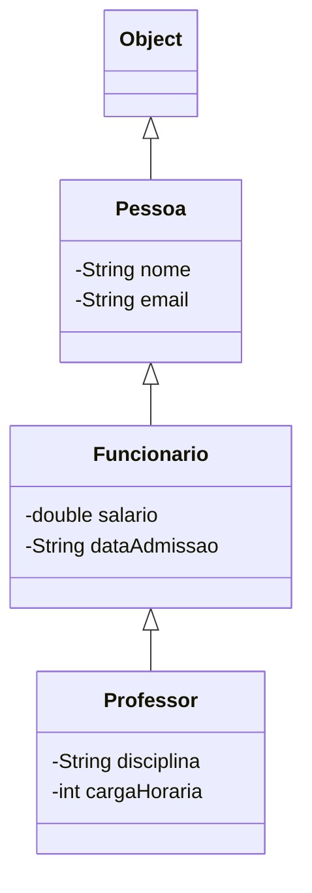

# ☕ Lista de Exercícios — Herança em Java


Lista prática para fixar os conceitos de **herança** em Java, com enunciados detalhados, cenários de teste e dicas.

---

## 📑 Sumário

- [🎯 Objetivos de aprendizagem](#-objetivos-de-aprendizagem)
- [📏 Regras gerais](#-regras-gerais)
- [Exercício 1 — Zoológico: Animal e suas subclasses](#exercício-1--zoológico-animal-e-suas-subclasses)
- [Exercício 2 — Escola: Pessoa, Aluno e Professor](#exercício-2--escola-pessoa-aluno-e-professor)
- [Exercício 3 — Locadora: Veículo, Carro, Moto e Caminhão](#exercício-3--locadora-veículo-carro-moto-e-caminhão)
- [Exercício 4 — RH: Funcionário, Gerente, Estagiário e Diretor](#exercício-4--rh-funcionário-gerente-estagiário-e-diretor)
- [Exercício 5 — Reaproveitando métodos com `super`](#exercício-5--reaproveitando-métodos-com-super)
- [Exercício 6 — Formas geométricas](#exercício-6--formas-geométricas)
- [Exercício 7 — Polimorfismo com arrays](#exercício-7--polimorfismo-com-arrays)
- [Exercício 8 — Banco: `protected` na prática](#exercício-8--banco-protected-na-prática)
- [Exercício 9 — Hierarquia em três níveis com `toString()`](#exercício-9--hierarquia-em-três-níveis-com-tostring)
- [Exercício 10 — Limitando a herança com `final`](#exercício-10--limitando-a-herança-com-final)
- [📊 Critérios de avaliação](#-critérios-de-avaliação)
- [📚 Referências](#-referências)

---

## 🎯 Objetivos de aprendizagem

Ao final desta lista, você deverá ser capaz de:

- Criar subclasses com `extends`
- Chamar construtores da classe-mãe com `super(...)`
- Sobrescrever métodos com `@Override`
- Reaproveitar comportamento da classe-mãe com `super.metodo()`
- Usar o modificador `protected` adequadamente
- Aplicar polimorfismo com referências do tipo da classe-mãe
- Verificar tipos com `instanceof`
- Restringir herança e sobrescrita com `final`

---

## 📏 Regras gerais

> Estas regras valem para **todos** os exercícios.

1. Atributos devem ser `private` (ou `protected`, quando o exercício pedir), com *getters* quando necessário.
2. Todo método sobrescrito deve ter a anotação `@Override`.
3. Cada exercício deve ter uma classe de teste (ex.: `TesteEx1`) com o método `main` executando **todos** os cenários descritos.
4. A saída no console deve ser **exatamente** a indicada nos cenários de teste.
5. Não copie código entre subclasses: se dois trechos são iguais, eles provavelmente pertencem à classe-mãe.

---

## Exercício 1 — Zoológico: Animal e suas subclasses


**Conceitos:** `extends` · sobrescrita · `super.metodo()` · polimorfismo implícito

### 📖 Contexto

Um zoológico quer um sistema simples para registrar seus animais e simular os sons que eles fazem.

### 🧩 Diagrama



### ✅ Requisitos

1. Crie a classe `Animal` com:
   - atributos `nome` (`String`) e `idade` (`int`);
   - construtor que recebe `nome` e `idade`;
   - método `emitirSom()`, que retorna `"Som genérico"`;
   - método `apresentar()`, que retorna `"<nome>, <idade> ano(s): <som>"`, usando o retorno de `emitirSom()`.
2. Crie as subclasses abaixo, cada uma sobrescrevendo `emitirSom()`:

   | Classe | Som |
   |--------|-----|
   | `Cachorro` | `Au au!` |
   | `Gato` | `Miau!` |
   | `Vaca` | `Muuu!` |
   | `Pato` | `Quack!` |

3. Crie a classe `Papagaio`, com o atributo extra `frase` (`String`). O som do papagaio é a frase que ele aprendeu. Se a frase for vazia ou `null`, ele deve usar o som da classe-mãe (`super.emitirSom()`).
4. **Não** sobrescreva `apresentar()` em nenhuma subclasse.

### 🧪 Cenários de teste

| # | Criação | Chamada | Saída esperada |
|:-:|---------|---------|----------------|
| 1 | `new Cachorro("Rex", 3)` | `apresentar()` | `Rex, 3 ano(s): Au au!` |
| 2 | `new Gato("Mimi", 2)` | `apresentar()` | `Mimi, 2 ano(s): Miau!` |
| 3 | `new Vaca("Mimosa", 5)` | `emitirSom()` | `Muuu!` |
| 4 | `new Papagaio("Louro", 10, "Olá, mundo!")` | `apresentar()` | `Louro, 10 ano(s): Olá, mundo!` |
| 5 | `new Papagaio("Zé", 1, "")` | `emitirSom()` | `Som genérico` |
| 6 | `new Animal("Desconhecido", 0)` | `apresentar()` | `Desconhecido, 0 ano(s): Som genérico` |

> [!TIP]
> Para testar se a frase é nula **ou** vazia, a ordem importa: `frase == null || frase.isEmpty()`. Se inverter, o cenário com `null` lança `NullPointerException`.

> [!NOTE]
> As subclasses precisam de um construtor próprio que chame `super(nome, idade)`, já que `Animal` não tem construtor sem parâmetros.

### 💭 Para refletir

Por que `apresentar()` mostra o som correto de cada animal, mesmo estando escrito só na classe `Animal`?

---

## Exercício 2 — Escola: Pessoa, Aluno e Professor


**Conceitos:** `super(...)` no construtor · `super.metodo()` · validação na classe-mãe

### 📖 Contexto

Uma escola precisa cadastrar alunos e professores, que compartilham dados pessoais.

### 🧩 Diagrama



### ✅ Requisitos

1. Classe `Pessoa` com `nome`, `cpf` e `idade`, construtor completo e método `exibirDados()`, que retorna:
   ```text
   Nome: <nome> | CPF: <cpf> | Idade: <idade>
   ```
2. Classe `Aluno extends Pessoa` com `matricula` e `curso`. O construtor deve usar `super(...)`. Sobrescreva `exibirDados()` reaproveitando o da classe-mãe e acrescentando:
   ```text
    | Matrícula: <matricula> | Curso: <curso>
   ```
3. Classe `Professor extends Pessoa` com `titulacao` (ex.: `"Mestre"`) e `disciplina`, seguindo o mesmo padrão.
4. Validação no construtor de `Pessoa`: se a idade for negativa, armazene `0`.

### 🧪 Cenários de teste

| # | Criação | Saída esperada de `exibirDados()` |
|:-:|---------|-----------------------------------|
| 1 | `new Aluno("Ana", "111", 19, "2024001", "ADS")` | `Nome: Ana \| CPF: 111 \| Idade: 19 \| Matrícula: 2024001 \| Curso: ADS` |
| 2 | `new Professor("Carlos", "222", 45, "Doutor", "POO")` | `Nome: Carlos \| CPF: 222 \| Idade: 45 \| Titulação: Doutor \| Disciplina: POO` |
| 3 | `new Aluno("Bia", "333", -5, "2024002", "SI")` | `Nome: Bia \| CPF: 333 \| Idade: 0 \| Matrícula: 2024002 \| Curso: SI` |

> [!TIP]
> A validação da idade fica **só** em `Pessoa`. Como `Aluno` e `Professor` chamam `super(...)`, eles ganham a regra de graça. O cenário 3 comprova isso.

> [!WARNING]
> A chamada `super(...)` precisa ser a **primeira instrução** do construtor da subclasse. Qualquer linha antes dela gera erro de compilação.

### 💭 Para refletir

O que acontece se você remover a chamada `super(...)` do construtor de `Aluno`? Por quê?

---

## Exercício 3 — Locadora: Veículo, Carro, Moto e Caminhão


**Conceitos:** sobrescrita com regra de negócio · reaproveitamento com `super`

### 📖 Contexto

Uma locadora calcula o valor do aluguel conforme o tipo de veículo.

### 🧩 Diagrama



### ✅ Requisitos

1. Classe `Veiculo` com `placa`, `modelo` e `valorDiaria` (`double`). Método `calcularAluguel(int dias)` retorna `valorDiaria * dias`.
2. `Carro extends Veiculo`: usa o cálculo padrão.
3. `Moto extends Veiculo`: **10% de desconto** sobre o valor padrão.
4. `Caminhao extends Veiculo`: atributo `capacidadeToneladas`; cobra **R$ 50,00 extras por dia para cada tonelada**, além do valor padrão.
5. Se `dias <= 0`, `calcularAluguel` retorna `0` em **todas** as classes. Implemente essa regra **uma única vez**, na classe-mãe.

### 🧪 Cenários de teste

| # | Veículo | Diária | Dias | Resultado esperado |
|:-:|---------|-------:|-----:|-------------------:|
| 1 | Carro | 100,00 | 3 | 300,00 |
| 2 | Moto | 80,00 | 5 | 360,00 |
| 3 | Caminhão (2 t) | 200,00 | 2 | 600,00 |
| 4 | Moto | 80,00 | 0 | 0,00 |
| 5 | Caminhão (3 t) | 150,00 | -1 | 0,00 |

> [!TIP]
> Na `Moto`, basta `return super.calcularAluguel(dias) * 0.9;`. Se o resultado da mãe for `0`, o desconto continua dando `0`.

> [!WARNING]
> O cenário 5 é uma armadilha: se o `Caminhao` somar a taxa extra sem checar os dias, o resultado será negativo. Verifique se `dias <= 0` antes de somar o adicional.

> [!NOTE]
> A classe `Carro` pode ficar praticamente vazia (só com o construtor). Isso é normal e mostra que a herança já entrega o comportamento padrão.

---

## Exercício 4 — RH: Funcionário, Gerente, Estagiário e Diretor


**Conceitos:** sobrescrita em cadeia · *template method* simples

### 📖 Contexto

A empresa paga bonificações diferentes conforme o cargo.

### 🧩 Diagrama



### ✅ Requisitos

1. `Funcionario` com `nome` e `salario`. `calcularBonificacao()` retorna **10%** do salário.
2. `Gerente extends Funcionario`: bonificação de **20%** do salário **+ R$ 500,00** fixos.
3. `Estagiario extends Funcionario`: não recebe bonificação (retorna `0`).
4. `Diretor extends Gerente`: bonificação do gerente **+ 5%** do salário. Use `super.calcularBonificacao()`.
5. Método `calcularSalarioTotal()` em `Funcionario`, que retorna `salario + calcularBonificacao()`. **Não** sobrescreva esse método.

### 🧪 Cenários de teste

| # | Cargo | Salário | Bonificação esperada | Salário total esperado |
|:-:|-------|--------:|---------------------:|-----------------------:|
| 1 | Funcionário | 3.000 | 300 | 3.300 |
| 2 | Gerente | 8.000 | 2.100 | 10.100 |
| 3 | Estagiário | 1.500 | 0 | 1.500 |
| 4 | Diretor | 15.000 | 4.250 | 19.250 |

> [!TIP]
> As subclasses precisam ler o salário para calcular a bonificação. Crie um `getSalario()` em `Funcionario` em vez de mudar o atributo para `public`.

> [!NOTE]
> Repare que `calcularSalarioTotal()` foi escrito uma vez só, mas dá o resultado certo para os quatro cargos. Esse é o poder da combinação entre herança e sobrescrita.

---

## Exercício 5 — Reaproveitando métodos com `super`


**Conceitos:** encadeamento de `super.metodo()` em vários níveis

### 📖 Contexto

Os relatórios de RH precisam exibir informações acumuladas ao longo da hierarquia.

### ✅ Requisitos

1. Usando as classes do Exercício 4, adicione o atributo `setor` em `Gerente` e `quantidadeSubordinados` em `Diretor`.
2. Crie `exibirInfo()` em `Funcionario`, que imprime:
   ```text
   Nome: <nome>
   Salário: R$ <salario>
   ```
3. Sobrescreva em `Gerente`: chama `super.exibirInfo()` e imprime `Setor: <setor>`.
4. Sobrescreva em `Diretor`: chama `super.exibirInfo()` e imprime `Subordinados: <quantidade>`.

### 🧪 Cenário de teste

```java
new Diretor("Marta", 15000, "Tecnologia", 40).exibirInfo();
```

Saída esperada:

```text
Nome: Marta
Salário: R$ 15000.0
Setor: Tecnologia
Subordinados: 40
```

> [!TIP]
> Copie o pacote do Exercício 4 para um novo pacote `ex05` e evolua a partir dele. Assim você mantém a versão anterior funcionando.

> [!TIP]
> Para entender a ordem de execução, coloque um *breakpoint* em cada `exibirInfo()` e rode no modo *debug* da sua IDE.

### 💭 Para refletir

Quantas vezes o método `exibirInfo()` de `Funcionario` foi executado? Desenhe a pilha de chamadas.

---

## Exercício 6 — Formas geométricas


**Conceitos:** herança em vários níveis · reaproveitamento de construtor · formatação de saída

### 🧩 Diagrama



### ✅ Requisitos

1. Classe `Forma` com atributo `nome` e métodos `calcularArea()` e `calcularPerimetro()`, ambos retornando `0`.
2. Subclasses:

   | Classe | Atributos | Observação |
   |--------|-----------|------------|
   | `Retangulo` | `base`, `altura` | — |
   | `Quadrado extends Retangulo` | — | recebe o lado e chama `super(lado, lado)` |
   | `Circulo` | `raio` | use `Math.PI` |
   | `Triangulo` | `ladoA`, `ladoB`, `ladoC` | área pela fórmula de Heron |

3. Método `descrever()` em `Forma`, que retorna `"<nome> - Área: <area> | Perímetro: <perimetro>"`, com 2 casas decimais.
4. Medidas negativas ou zero devem ser substituídas por `1`.

### 🧪 Cenários de teste

| # | Forma | Medidas | Área | Perímetro |
|:-:|-------|---------|-----:|----------:|
| 1 | Retângulo | 4 × 5 | 20,00 | 18,00 |
| 2 | Quadrado | lado 3 | 9,00 | 12,00 |
| 3 | Círculo | raio 2 | 12,57 | 12,57 |
| 4 | Triângulo | 3, 4, 5 | 6,00 | 12,00 |
| 5 | Retângulo | -2 × 5 | 5,00 | 12,00 |

> [!TIP]
> **Fórmula de Heron:** sendo `s = (a + b + c) / 2`, a área é `Math.sqrt(s * (s - a) * (s - b) * (s - c))`.

> [!TIP]
> Use `String.format("%.2f", valor)` para as 2 casas decimais. Em computadores configurados em português, o separador sai como vírgula (`20,00`); em inglês, como ponto (`20.00`). Os dois são aceitos.

> [!NOTE]
> O nome da forma pode ser passado pela subclasse no `super(...)`: `super("Retângulo")`. Mas como o `Quadrado` chama o construtor do `Retangulo`, ele vai acabar com o nome errado. Como resolver?

### 💭 Para refletir

`Quadrado` precisou sobrescrever algum método? Por quê?

---

## Exercício 7 — Polimorfismo com arrays


**Conceitos:** polimorfismo · referência do tipo da mãe · `instanceof`

### ✅ Requisitos

1. Usando as classes do Exercício 6, crie um `Forma[] formas` com pelo menos 6 objetos de tipos variados.
2. Percorra o array e imprima `descrever()` de cada forma.
3. Calcule e imprima a **soma total das áreas**.
4. Encontre e imprima a forma com **maior área**.
5. Conte quantos objetos são `Retangulo` usando `instanceof`.

### 🧪 Cenário de teste

```java
Forma[] formas = {
    new Retangulo(4, 5),
    new Quadrado(3),
    new Circulo(2),
    new Triangulo(3, 4, 5),
    new Circulo(1),
    new Quadrado(5)
};
```

| Verificação | Resultado esperado |
|-------------|--------------------|
| Soma das áreas | **75,71** |
| Maior área | **Quadrado - Área: 25,00 \| Perímetro: 20,00** |
| Quantidade de `instanceof Retangulo` | **3** |

> [!TIP]
> Use o *enhanced for* para deixar o código mais limpo: `for (Forma f : formas) { ... }`.

> [!TIP]
> Para achar a maior área, comece guardando a primeira forma do array como "maior" e vá comparando com as seguintes.

> [!IMPORTANT]
> O resultado `3` no `instanceof` não é erro: um `Quadrado` **é um** `Retangulo`. Explique isso com suas palavras no código.

---

## Exercício 8 — Banco: `protected` na prática


**Conceitos:** `protected` · sobrescrita com regra diferente · retorno booleano para validação

### 🧩 Diagrama



### ✅ Requisitos

1. `ContaBancaria` com `numero`, `titular` e `protected double saldo`. Métodos:
   - `depositar(double valor)`: rejeita valores ≤ 0 (retorna `false`).
   - `sacar(double valor)`: rejeita valores ≤ 0 ou maiores que o saldo (retorna `false`).
2. `ContaPoupanca extends ContaBancaria`: método `renderJuros(double taxaPercentual)`, que altera `saldo` diretamente.
3. `ContaCorrente extends ContaBancaria`: atributo `limite` (cheque especial). Sobrescreva `sacar()` para permitir saque até `saldo + limite`.
4. `ContaCorrente` cobra **R$ 2,00 de tarifa** por saque realizado com sucesso.

### 🧪 Cenários de teste

| # | Conta | Operações | Saldo final esperado | Retorno |
|:-:|-------|-----------|---------------------:|:-------:|
| 1 | Poupança | deposita 1000 → rende 1% | 1.010,00 | — |
| 2 | Poupança | deposita 100 → saca 150 | 100,00 | `false` |
| 3 | Corrente (limite 500) | deposita 100 → saca 400 | -302,00 | `true` |
| 4 | Corrente (limite 500) | deposita 100 → saca 700 | 100,00 | `false` |
| 5 | Qualquer | deposita -50 | 0,00 | `false` |

> [!TIP]
> Os juros de 1% significam `saldo += saldo * taxaPercentual / 100;`. Cuidado para não multiplicar o saldo por 1 (o que não muda nada) ou por 100.

> [!WARNING]
> Ao validar o saque na `ContaCorrente`, decida se a tarifa entra no limite. Nesta lista, a regra é: o **valor sacado** precisa caber em `saldo + limite`; a tarifa é descontada depois.

> [!NOTE]
> Em Java, `protected` também libera acesso para classes do **mesmo pacote**, não só para as subclasses. Isso costuma surpreender quem vem de outras linguagens.

### 💭 Para refletir

Troque `saldo` para `private` e tente compilar. O que acontece? Como resolver **sem** usar `protected`?

---

## Exercício 9 — Hierarquia em três níveis com `toString()`


**Conceitos:** ordem de execução dos construtores · sobrescrita de `Object.toString()`

### 🧩 Diagrama



### ✅ Requisitos

1. Monte a hierarquia `Pessoa → Funcionario → Professor` com os atributos do diagrama.
2. Cada construtor chama o da classe-mãe com `super(...)`.
3. Cada classe sobrescreve `toString()` reaproveitando o `toString()` da mãe:

   | Classe | Formato |
   |--------|---------|
   | `Pessoa` | `Pessoa[nome=Ana, email=ana@escola.com]` |
   | `Funcionario` | `<toString da mãe> Funcionario[salario=5000.0, admissao=01/03/2020]` |
   | `Professor` | `<toString da mãe> Professor[disciplina=POO, CH=40]` |

4. Coloque um `System.out.println("Construindo <NomeDaClasse>")` em cada construtor.

### 🧪 Cenário de teste

```java
Professor prof = new Professor("Ana", "ana@escola.com", 5000, "01/03/2020", "POO", 40);
System.out.println(prof);
```

Saída esperada:

```text
Construindo Pessoa
Construindo Funcionario
Construindo Professor
Pessoa[nome=Ana, email=ana@escola.com] Funcionario[salario=5000.0, admissao=01/03/2020] Professor[disciplina=POO, CH=40]
```

> [!TIP]
> `System.out.println(prof)` chama `prof.toString()` automaticamente. Não é preciso escrever `.toString()`.

> [!TIP]
> Toda classe em Java herda de `Object`, mesmo sem escrever `extends`. Por isso `toString()` existe em `Pessoa` antes de você sobrescrevê-lo. Teste imprimir uma `Pessoa` antes de sobrescrever e veja o que aparece.

### 💭 Para refletir

Por que os construtores executam de cima para baixo na hierarquia, mesmo que você tenha criado um `Professor`?

---

## Exercício 10 — Limitando a herança com `final`


**Conceitos:** método `final` · classe `final` · leitura de erros de compilação

### ✅ Requisitos

1. Classe `Produto` com `nome` e `preco`. Método `public final double calcularImposto()`, que retorna **15%** do preço.
2. Método `calcularPrecoFinal()` (não `final`), que retorna `preco + calcularImposto()`.
3. `Eletronico extends Produto`: sobrescreva `calcularPrecoFinal()` somando uma **taxa de garantia de R$ 30,00**.
4. Tente sobrescrever `calcularImposto()` em `Eletronico`. Anote a mensagem de erro e depois remova a tentativa.
5. Declare `Eletronico` como `final` e tente criar `Celular extends Eletronico`. Anote o erro.
6. Responda em comentários: em que situações reais faz sentido usar `final` em classe ou método?

### 🧪 Cenários de teste

| # | Ação | Preço | Imposto | Preço final |
|:-:|------|------:|--------:|------------:|
| 1 | `new Produto("Caderno", 20)` | 20,00 | 3,00 | 23,00 |
| 2 | `new Eletronico("Fone", 200)` | 200,00 | 30,00 | 260,00 |
| 3 | Sobrescrever `calcularImposto()` | — | — | ❌ Erro de compilação |
| 4 | `class Celular extends Eletronico` | — | — | ❌ Erro de compilação |

> [!TIP]
> Copie as mensagens de erro do compilador para dentro do código, como comentário. Aprender a ler erros de compilação é tão importante quanto escrever código que compila.

> [!TIP]
> Pesquise por que a classe `String` do Java é `final`. A resposta tem a ver com segurança e imutabilidade.

> [!NOTE]
> Métodos `final` ainda são **herdados** — só não podem ser **sobrescritos**. O `Eletronico` continua chamando `calcularImposto()` normalmente.

---

## 📊 Critérios de avaliação

| Critério | Peso |
|----------|:----:|
| ✅ Código compila sem erros | 20% |
| 🧪 Cenários de teste produzem a saída esperada | 40% |
| 🧬 Uso correto de `super`, `@Override` e modificadores de acesso | 20% |
| 💭 Respostas às perguntas de reflexão | 20% |

---

## 📚 Referências

- [The Java™ Tutorials — Inheritance (Oracle)](https://docs.oracle.com/javase/tutorial/java/IandI/subclasses.html)
- [The Java™ Tutorials — Using the Keyword super](https://docs.oracle.com/javase/tutorial/java/IandI/super.html)
- [The Java™ Tutorials — Writing Final Classes and Methods](https://docs.oracle.com/javase/tutorial/java/IandI/final.html)
- [The Java™ Tutorials — Polymorphism](https://docs.oracle.com/javase/tutorial/java/IandI/polymorphism.html)

---

<p align="center">
  Bons estudos! Dúvidas? Abra uma <em>issue</em> neste repositório.
</p>
